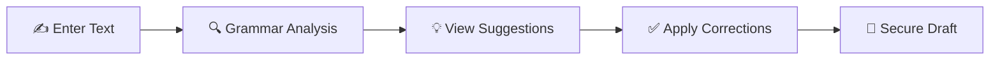
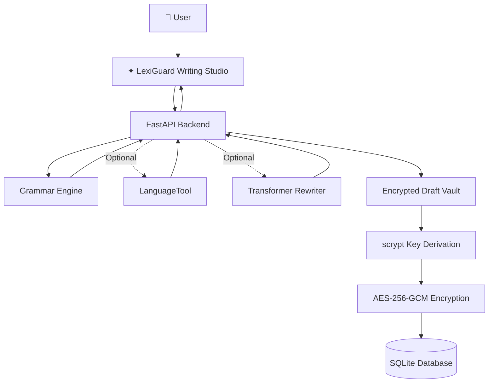
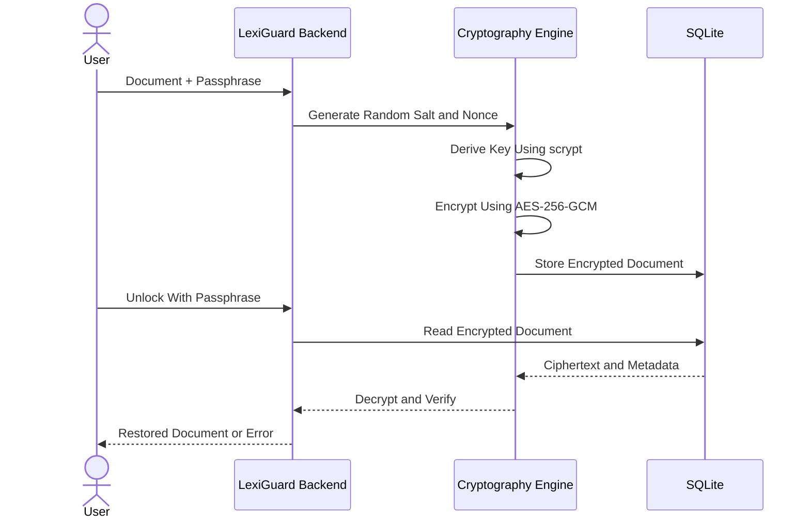

<div align="center">

# ✦ LEXIGUARD

### AI Grammar Assistant · Smarter Writing · Protected Drafts


**An original Grammarly-inspired writing assistant with NLP, optional AI models, and encrypted drafts.**

[](https://www.python.org/)
[](https://fastapi.tiangolo.com/)
[](https://developer.mozilla.org/en-US/docs/Web/JavaScript)
[](#-cryptography--secure-draft-vault)
[](LICENSE)

**[Features](#-features) · [Demo](#-writing-demo) · [Installation](#-quick-start) · [AI Models](#-optional-ai-and-languagetool) · [Security](#-cryptography--secure-draft-vault) · [API](#-api-reference)**

</div>

---

## 🌌 About LexiGuard

**LexiGuard** is a modern, responsive English writing assistant that analyzes text, explains potential grammar errors, recommends corrections, and lets users protect saved drafts with a passphrase.

It is built with a **FastAPI backend**, a **JavaScript frontend**, and optional transformer-based language correction.

> [!NOTE]
> LexiGuard is an independent, working local MVP. It is not affiliated with Grammarly and does not claim the same accuracy or production capabilities.

## ✨ Features

| | Feature | Description |
|:--:|---|---|
| ✍️ | **Writing Studio** | Responsive dashboard, modern editor, dark mode, custom logo |
| ✅ | **Grammar Checker** | Detects common spelling, grammar, capitalization and punctuation mistakes |
| ⚡ | **One-click Corrections** | Review individual suggestions and apply fixes |
| 📊 | **Writing Analytics** | Word count, sentence statistics, reading time and heuristic score |
| 🧠 | **AI Rewriting** | Optional Hugging Face transformer-based text rewriting |
| 🔎 | **LanguageTool** | Optional deeper grammar analysis with a local LanguageTool engine |
| 🔐 | **Encrypted Vault** | AES-256-GCM encrypted document storage |
| 🛠️ | **REST API** | FastAPI endpoints with interactive Swagger documentation |

## 🎬 Writing Demo

### Before correction

```text
She have teh wrong adress and i dont recieve the message
```

### After correction

```diff
- She have teh wrong adress and i dont recieve the message
+ She has the wrong address and I don't receive the message.
```

The built-in checker offers suggestions with explanations instead of forcing automatic changes.

### How it works



## 🧩 Technology Stack

| Layer | Technology |
|---|---|
| Frontend | HTML5, CSS3, JavaScript |
| Backend | Python 3.10+, FastAPI, Uvicorn |
| Grammar Analysis | Rule-based NLP and regex |
| Optional NLP | LanguageTool |
| Optional Machine Learning | Hugging Face Transformers, PyTorch |
| Encryption | AES-256-GCM |
| Key Derivation | scrypt |
| Database | SQLite |
| Testing | Python unittest |

## 🏗️ System Architecture



## 🚀 Quick Start

### Prerequisites

- Python 3.10 or later
- pip
- Modern web browser

No external API key is necessary for the built-in grammar checker or encrypted vault.

### Windows — VS Code Terminal

```powershell
py -m venv .venv
.\.venv\Scripts\Activate.ps1

python -m pip install -r requirements.txt

python -m uvicorn backend.main:app --reload --host 127.0.0.1 --port 8000
```

Open the website:

**http://127.0.0.1:8000**

Open API documentation:

**http://127.0.0.1:8000/docs**

### macOS / Linux

```bash
python3 -m venv .venv
source .venv/bin/activate

python -m pip install -r requirements.txt

python -m uvicorn backend.main:app --reload --host 127.0.0.1 --port 8000
```

## 🤖 Optional AI and LanguageTool

### Transformer AI Model

Install optional machine-learning dependencies:

```powershell
python -m pip install -r requirements-ml.txt
```

The default transformer is:

`vennify/t5-base-grammar-correction`

You can configure another compatible model through:

`LEXIGUARD_ML_MODEL`

Transformer weights are downloaded on first use and require additional storage and memory.

The AI suggests a rewrite for review. It does not silently replace the original document.

### LanguageTool

Install a compatible Java runtime, then run:

```powershell
python -m pip install -r requirements-language-tool.txt
```

Restart the application and select LanguageTool from the editor.

## 🔐 Cryptography & Secure Draft Vault

LexiGuard combines writing assistance with a demonstration of authenticated document encryption.

### Encryption Workflow



### Security Features

- **AES-256-GCM:** Authenticated encryption for draft title and content.
- **scrypt:** Passphrase-based 256-bit key derivation.
- **Random Salt:** A new 16-byte salt for each draft.
- **Random Nonce:** A new 12-byte nonce for each draft.
- **Authenticated Data:** The draft ID is bound to the ciphertext.
- **Encrypted Database Records:** SQLite stores ciphertext and encryption metadata instead of plaintext document content.
- **Passphrase Protection:** The database does not store the encryption key or passphrase.

> [!WARNING]
> This is a single-user localhost security demonstration, not a production multi-user vault. The server receives plaintext and passphrases, so it is not end-to-end or zero-knowledge encryption. Public deployment requires HTTPS, authentication, user authorization, rate limiting, backups, and security testing.

## 📂 Project Structure

```text
LexiGuard-AI-Grammar-Assistant/
│
├── backend/
│   ├── main.py
│   ├── engine.py
│   ├── ml.py
│   └── secure_store.py
│
├── frontend/
│   ├── index.html
│   └── assets/
│       ├── app.js
│       ├── styles.css
│       ├── logo.svg
│       └── favicon.svg
│
├── tests/
│   └── test_project.py
│
├── docs/
│   └── architecture.md
│
├── requirements.txt
├── requirements-ml.txt
├── requirements-language-tool.txt
├── .gitignore
├── LICENSE
└── README.md
```

## 🔌 API Reference

| Method | Endpoint | Description |
|---|---|---|
| GET | `/api/health` | Health check |
| POST | `/api/analyze` | Analyze grammar and spelling |
| POST | `/api/rewrite` | Optional AI-powered rewrite |
| POST | `/api/vault` | Encrypt and save a draft |
| GET | `/api/vault` | List saved encrypted draft IDs |
| POST | `/api/vault/{id}/unlock` | Unlock a draft |
| DELETE | `/api/vault/{id}` | Delete a draft |
| GET | `/docs` | Swagger API documentation |

### Example API Request

```bash
curl -X POST http://127.0.0.1:8000/api/analyze \
  -H "Content-Type: application/json" \
  -d '{"text":"She have teh wrong adress","engine":"built-in"}'
```

## 🧪 Testing

Run the bundled tests:

```powershell
python -m unittest discover -s tests -v
```

## 🗺️ Development Roadmap

- [x] Responsive website and writing studio
- [x] Grammar and spelling suggestions
- [x] One-click grammar corrections
- [x] Writing statistics
- [x] AES-256-GCM encrypted vault
- [x] Optional LanguageTool integration
- [x] Optional transformer model integration
- [ ] Train and benchmark specialized grammar correction models
- [ ] Improve correction accuracy and long-document support
- [ ] Implement authentication and user-specific vaults
- [ ] Browser extension
- [ ] Document import/export
- [ ] Production deployment and security hardening

## 🌱 Contributing

Contributions, bug reports, and improvements are welcome.

Please do not commit virtual environments, large machine-learning weights, local databases, or secret configuration files.

## 📜 License

Released under the [MIT License](LICENSE).

LexiGuard is an independent project, not affiliated with or endorsed by Grammarly.

---

<div align="center">

### ✦ LexiGuard

**Write brilliantly. Edit confidently. Keep drafts protected.**

[⭐ Star the Repository](https://github.com/Darshan-paapani06/LexiGuard-AI-Grammar-Assistant) · [🐛 Report an Issue](https://github.com/Darshan-paapani06/LexiGuard-AI-Grammar-Assistant/issues)

<sub>Built using Python, NLP, Machine Learning and Cryptography.</sub>

</div>
